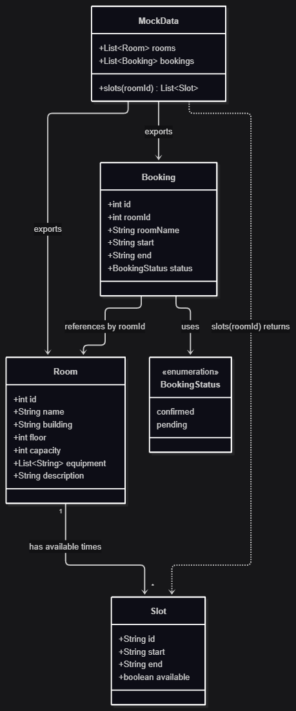

# SDU Booking: Data Structure

This document describes the data the frontend expects from the backend API.
All responses are JSON. The base URL is set with `VITE_API_URL` (see `.env.example`).

The frontend is read-only for now: it only fetches and displays data.

## Entities

### Room

A bookable room on campus.

| Field         | Type       | Description                                  | Example                          |
| ------------- | ---------- | -------------------------------------------- | -------------------------------- |
| `id`          | number     | Unique room id                               | `1`                              |
| `name`        | string     | Room code shown to users                     | `"A101"`                         |
| `building`    | string     | Building the room is in                      | `"Main Building"`                |
| `floor`       | number     | Floor number (`0` = ground)                  | `1`                              |
| `capacity`    | number     | Maximum number of people                     | `30`                             |
| `equipment`   | string[]   | Equipment available in the room              | `["Projector", "Whiteboard"]`    |
| `description` | string     | Short free-text description                  | `"Standard Classroom"`     |

```json
{
  "id": 1,
  "name": "A101",
  "building": "Main Building",
  "floor": 1,
  "capacity": 30,
  "equipment": ["Projector", "Whiteboard"],
  "description": "Standard Classroom."
}
```

### Slot

A bookable time window for one room.

| Field       | Type    | Description                                   | Example                |
| ----------- | ------- | --------------------------------------------- | ---------------------- |
| `id`        | string  | Unique slot id (`<roomId>-<n>` in mock data)  | `"1-1"`                |
| `start`     | string  | Start time, ISO 8601 local date-time          | `"2026-10-21T09:00"`   |
| `end`       | string  | End time, ISO 8601 local date-time            | `"2026-10-21T10:30"`   |
| `available` | boolean | `true` if the slot can still be booked        | `true`                 |

```json
{
  "id": "1-1",
  "start": "2026-10-21T09:00",
  "end": "2026-10-21T10:30",
  "available": true
}
```

### Booking

A reservation made by the current user.

| Field      | Type   | Description                                      | Example                |
| ---------- | ------ | ------------------------------------------------ | ---------------------- |
| `id`       | number | Unique booking id                                | `101`                  |
| `roomId`   | number | `id` of the booked Room                          | `2`                    |
| `roomName` | string | Room `name`, included so the UI needs no lookup  | `"A204"`               |
| `start`    | string | Start time, ISO 8601 local date-time             | `"2026-10-22T11:00"`   |
| `end`      | string | End time, ISO 8601 local date-time               | `"2026-10-22T12:30"`   |
| `status`   | string | `"confirmed"` or `"pending"`                     | `"confirmed"`          |

```json
{
  "id": 101,
  "roomId": 2,
  "roomName": "A204",
  "start": "2026-10-22T11:00",
  "end": "2026-10-22T12:30",
  "status": "confirmed"
}
```

## Relationships

```
Room 1 ──── * Slot        a room has many time slots
Room 1 ──── * Booking     a room can appear in many bookings
```

- `Booking.roomId` references `Room.id`.
- `Booking.roomName` duplicates `Room.name` (denormalised) for display.
- `Slot` is identified within a room; the slot list endpoint is scoped to one room.

## Endpoints

| Method | Path                | Returns      | Used by                  |
| ------ | ------------------- | ------------ | ------------------------ |
| GET    | `/rooms`            | `Room[]`     | Rooms page               |
| GET    | `/rooms/:id`        | `Room`       | Room detail page         |
| GET    | `/rooms/:id/slots`  | `Slot[]`     | Room detail page         |
| GET    | `/bookings`         | `Booking[]`  | My bookings page         |

## Future database implementation

We may follow this diagram as an idea for future database implementation.

